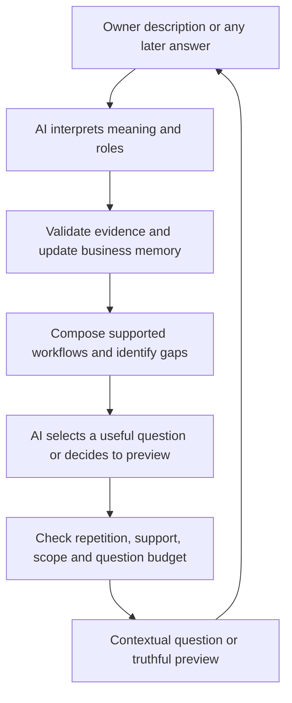

# VenQore builder v3: an AI business interview that remembers what it hears

18 October 2026. Design revision only. No application implementation in this work.

This addendum governs description understanding, question choice and session continuity wherever BUILDER_FINAL_PLAN.md, BUILDER_DECISION_SYSTEM_V2.md or the existing implementation disagrees. The previous workflow bundles, live-capability checks, low-clutter presentation and eight/ten-screen budget remain in force.

The owner's latest direction is decisive: AI should reason about the actual business and choose the right next question, including useful questions we did not pre-write. It must not be restricted to paraphrasing a fixed script. The deterministic layer validates evidence, compatibility and the resulting configuration; it is not the entire interviewer.

## 1. The corrected experience

Description:

> Auto parts distributor with 10,000 SKUs across two warehouses, counter sales for walk-ins, and tiered credit accounts for repair shops.

A competent interviewer hears: goods distribution; a large item catalogue; stock held across two warehouses; walk-in counter checkout; customer credit for repair-shop accounts. It does not hear: our business repairs vehicles, we pay suppliers later, every item has a serial number, or credit tiers necessarily change selling prices.

The interface should first reflect a concise understanding:

> You distribute auto parts, manage 10,000 SKUs across two warehouses, serve walk-in customers at a counter, and offer repair shops credit accounts.

Then ask an actual unresolved question, for example:

> For repair-shop accounts, do the tiers change prices, credit terms, or both?

Options: Different prices / Different credit terms or limits / Both / Something else.

This question earns its place because the phrase tiered credit accounts is ambiguous and the supported pricing/credit behaviour can differ. If the owner had explicitly said different prices for repair shops, do not ask it. If the existing credit feature cannot supply the requested limits/terms, retain and disclose that gap; ordinary balance tracking is not an equivalent promise.

There is no mandatory question asking whether they sell products, have stock, operate more than one warehouse or use counter sales. There is also no automatic question asking whether they do repairs merely because their customers are repair shops.

## 2. What went wrong: observed source versus hypothesis

Inspected current files under app-code/main-app on 18 October. These are source findings, not a reproduced live browser/network session. The screenshot establishes repeated activity discovery and an inconsistent Restaurant label, but does not by itself establish which saved session or request produced them.

| Finding | Evidence in source | Consequence |
|---|---|---|
| Extractor has very narrow coverage | FactExtractor::RULES has 11 entries, without goods/distributor, SKU count, two warehouses, counter selling or tiered-account understanding | This opening cannot populate its most important facts through the keyword fallback. |
| Customer role mistaken for owner activity | Repairs regex writes activity.services for a repair word, including repair shops | A buyer/customer description can incorrectly give the owner a service business. |
| AI extraction hook is not supplied by the inspected binding | AppServiceProvider constructs BuilderEngine without its optional AI callable | Adding an AI-shaped interface did not make semantic extraction active on this path. The earlier BusinessUnderstanding service is separate. |
| Text omitted when type/preset present | BuilderV2 boot sends sentence undefined for initialType or initialPreset | Real owner detail can be lost before extraction. |
| Server also skips text on a type-selected run | BuilderEngine::start applies extractor only when type is null | Correcting only the browser handoff would still leave the loss. |
| Selected food type promoted to manufacturing evidence | BuilderEngine::start writes food activity.goods and activity.making as answers | Sector is being treated as explicit operational evidence, contrary to the design. A reseller bakery is a counterexample. |
| No schema location for numbers | Current FactStore/set and facts.php chiefly support bool/string; no SKU or physical warehouse count fields | Even a model noticing 10,000/two cannot faithfully preserve them as structured numeric observations without a design extension. |
| Held stock tied to buying in current item fact | items.resale_stock means products I buy to resell; derived procurement/quantity rules share it | Warehouses and catalogue evidence cannot safely map into this fact without inventing procurement. |
| Some business-important screens never asked automatically | ScreenSelector only auto-selects bands 1-4; places/pricing are in optional bands unless raised | A known multi-warehouse or pricing need can remain unaddressed because of a static band boundary. |
| Confirmation is not a clear trust boundary | Extractor sets owner_text to confirmed status, then sets pending_confirm; known/isTrue do not exclude pending records | Source comment says not confirmed until acceptance, but selection/composition can already use it. Decide evidence usability explicitly. |
| Generic none can write negatives for untouched options | BuilderEngine::answer writes false for shown-but-not-chosen booleans | With guessed/extracted context, a default empty Continue can erase or contradict information. |
| New input can resume old interview | BuilderV2 tries saved-session resume before evaluating the new initial inputs; api.js stores session ID/type without an input fingerprint | New descriptions can potentially inherit old questions. This is a source-level risk, not a confirmed cause of this screenshot. |
| Shell and interview can use different identities | Outer BuildWorkspace displayLabel uses persisted businessLabel/presetLabel; inner interview has its own session state | Restaurant label can be inconsistent with interview evidence. Determine the exact cause from session/request logs; do not assume cache is the only cause. |
| Follow-up explanations are not consistently semantically ingested | answer stores explanation fields, but its normal path does not run FactExtractor::apply on them | Information volunteered after the opening can also fail to influence the next question. |

This is not solved by adding warehouse, distributor and repair-shop regexes alone. We need an end-to-end understanding and interviewing contract.

## 3. AI is the interviewer; software is the evidence and configuration authority

AI is responsible for:

- Understanding the owner's full description, not just category matching.
- Identifying who does what, for whom, with whose goods and money.
- Combining details from every turn into a coherent business picture.
- Separating known information, reasonable implications, ambiguous interpretations and unknowns.
- Identifying the most consequential unresolved issue and choosing a useful question.
- Writing natural, relevant questions and answer options in the owner's language.
- Handling an unusual business or mixed model without requiring a pre-authored scenario.
- Deciding to stop asking when the known supported workflows are sufficiently specified.

The deterministic layer is responsible for:

- Checking schema/types, evidence references, source/revision, repeated questions and contradictions.
- Rejecting unsupported claims, invalid dependencies and unsafe activation defaults.
- Composing verified workflow bundles, permissions and entitlement-aware proposals.
- Enforcing question budget, session continuity and truthful completion status.
- Serving a clear fallback when the AI is unavailable or its output cannot be accepted.

AI may select a prepared question, adapt a related one, or generate a new clarification. It does not need to choose from eight fixed question IDs. Prepared questions become a reviewed library of examples and fallback patterns, rather than the full boundary of possible reasoning.

Do not replace AI reasoning with another large keyword catalogue or an 85-by-module lookup table. Also do not allow an unconstrained chat response to become the applied module configuration.

## 4. The working business memory

Maintain an explicit, versioned business brief alongside the immutable messages. It is a compact working memory, not a second source of truth. Facts and evidence remain authoritative; the brief is regenerated or checked against them.

Its contents:

- Owner activities, offerings, customers, suppliers and other actors.
- Sales channels and work/order lifecycle.
- Goods/material ownership, quantity handling and procurement separately.
- Money timing, customer groups, pricing and credit rules separately.
- Places, people and item-identity requirements.
- Already supported workflows; requested unsupported needs.
- Remaining material unknowns; conflicting interpretations.
- Questions asked, information resolved and questions the owner skipped.

Represent extracted observations with subject, relation, object/value, polarity, time/modal scope and source span. Example: owner sells parts TO repair shops. The customer noun repair does not establish owner performs repair work.

Four evidence classes:

1. Explicit: counter sales for walk-ins; two warehouses; 10,000 SKUs.
2. Strong semantic implication: an auto-parts distributor with warehoused SKUs deals in physical goods; in context it handles stock.
3. Interpretation needing clarification: tiered credit accounts could mean price tiers, credit terms/limits, or both.
4. Prior or guess: distributors usually buy from suppliers; they may ship deliveries or use barcode scanners. Do not assert these.

Usable explicit and strong semantic facts can suppress redundant discovery immediately. They need not each force a confirmation screen. Show an editable understanding summary; target clarification to ambiguous/high-impact claims. This corrects earlier blanket rules that made all AI-extracted text pending even when the meaning was clear.

Evidence level and owner verification are separate attributes. A fact can be usable, sourced to the owner's sentence and not yet individually reviewed. Do not call it owner-confirmed until actually confirmed; do not call a trade prior owner-text evidence.

Keep short decision reasons for audit. Do not request or persist private chain-of-thought. A rationale such as Tier may change prices or credit rules; clarify before choosing those workflows is sufficient.

## 5. Extract the opening in full, through every entry route

Input envelope must retain separately:

- attempt ID and input revision;
- exact owner-authored description and language;
- selected type and preset, with origin explicitly selected versus inferred;
- generated template text, separately marked generated;
- current session ID only for the same attempt;
- policy, schema and extraction versions.

All meaningful owner text is processed whether or not a type/preset exists. Generated marketing/template copy is not owner testimony. Stop using the presence of type/preset as a proxy for whether text is genuine.

Explicit owner detail outranks an inferred category or prior. A person who selects restaurant but writes auto-parts distribution needs a narrow category mismatch resolution, not invented cooking/table facts. Retain the operational facts while resolving the label. If the restaurant value is stale session state rather than an explicit new selection, discard stale identity instead of asking the user to fix our state bug.

Extraction covers all supported facts in the message, not only the current question's target. Facts learned from one answer can settle several later questions. Parse follow-up explanations, missing-feature text, description edits and relevant read-back corrections through the same semantic path.

Store exact numeric observations even if they do not change module selection. 10,000 SKUs can inform scale/read-back/import setup; it never implies barcodes, variants, serials or branches. Two warehouses gives a physical warehouse count; it does not mean two employees or two retail counters.

### Minimal schema corrections proposed

These are proposed schema requirements, not code changes made here.

- Separate held-for-sale goods from procurement: introduce a quantity/holding fact such as items.held_for_sale and an independent procurement.buys_stock. Derive quantity management and purchasing from their own evidence.
- Existing explicit Q3 Products I buy to sell again can write both holding and procurement. An extracted warehouse description writes holding only.
- Add typed numeric observation storage, e.g. catalogue.sku_count = 10000 and place.warehouse_count = 2, with exact/approximate marker and original words. Current bool/string setters must not receive fabricated booleans for numeric meaning.
- Keep physical location count separate from whether the owner wants independent stock counts. Multi-warehouse management can be recommended from two warehouses with that setting clearly proposed, not falsely recorded as an explicit count-setting answer.
- Track tier meaning before setting repeat.group_prices. Customer credit is supported by credit accounts; different selling prices are not yet established by this exact phrase.
- Retain repair shops as customer segment; do not write activity.services for the owner from that span.
- Unknown specialised requirements remain preserved as observations/needs even when no existing fact key can encode them. They enter module composition only through a validated semantic mapping, not a model-invented module or arbitrary executable rule.

## 6. The intelligent interview loop

1. Read the new message together with current authoritative facts, unresolved needs and question history. Use full raw history while short; for longer interviews use compact evidence memory plus original cited spans and make original turns available when needed.
2. Extract evidence-grounded additions, corrections, negatives and interpretations; preserve subject/customer/supplier roles.
3. Validate and merge into a new state revision. Resolve explicit correction versus contradiction; never silently erase earlier business evidence from an empty multi-select.
4. Compose current supported workflows and identify material gaps or configuration differences.
5. AI chooses the next action: ask, show understanding/preview, clarify a conflict, disclose a support gap, or finish.
6. Validate the proposed action against the actual post-merge revision, known facts, support map and budget.
7. Show the selected question or result, then repeat from the next answer.

This process starts with the opening sentence, before allocating question 1. The opening is a rich first answer, not merely a prompt for choosing a template.

Question priority is a judgement over consequences:

- Could a misunderstanding make the central workflow unusable?
- Is a necessary fact missing, or is the model just curious?
- Would different answers actually change capabilities or important setup?
- Is the answer already explicit/entailed in any earlier message?
- Can a narrower question settle the gap without restarting discovery?
- Is the effort proportionate? Is the user ready to preview instead?

Resolve contradictions, essential ownership/fulfilment, and supported workflow gaps before optional programmes. Static priority bands are useful fallback heuristics, not a rule that places/pricing are always optional. For this owner, warehouses and trade accounts are central.

Questions can change order with context. There is no universally correct first follow-up. For the distributor example, tier meaning is an excellent first question; supplier source can outrank it if unresolved ownership would prevent composing an essential buying workflow.

## 7. Structured contract for the AI turn

The API receives the owner's new message as business data, plus versioned context: facts with evidence, observation roles, known workflows, exact available capabilities, unsupported requests, prior questions, current budget and current state revision. Type hints are explicitly marked suggestions. Model instructions are separate from owner text.

It returns a structured proposal with:

- observed additions/corrections, each citing message ID and evidence span;
- plausible interpretations, separate from usable facts;
- uncovered requirements that the current schema cannot encode;
- short updated business brief, checked against facts;
- next action: ask / preview / clarify / unsupported / finish;
- for a question: target information, relevant context, wording, answer choices or free-text mode, and the material difference it resolves;
- one or two alternative next questions when useful;
- a short decision reason, not a hidden reasoning transcript;
- expected input/state revision.

The planner can compose a new question. Target facts and interpretation alternatives are checked against typed semantic concepts/capability scope; generated option IDs are registered with the pending server-side question. The browser displays those IDs and sends them back; it cannot independently write arbitrary facts or modules.

A new real-world requirement outside the schema is retained as an observation/gap, not discarded. AI may ask a narrow business-goal clarification to identify a supported approximation or expose the limitation. It must not create new capabilities by inventing a fact key. If the unsupported need is already clear, disclose it without wasting more questions describing a feature we cannot supply.

After merging an answer, the server revalidates whether any suggested question is still needed. A combined extraction/planning response is acceptable only if its question remains valid against the actual merged revision. Otherwise try a valid alternative, ask the planner again using the composed state, or use the contextual fallback.

Two logical stages are acceptable: interpret/merge, then plan from verified state. Optimise the number of calls only after correctness and measured latency. Do not force one call by letting the planner work from stale facts.

Use the existing AiGateway for scope/rate/spend/schema control. Wire the new interview path deliberately; the existence of BusinessUnderstanding or an unused callable does not prove the model participates. Log semantic versus fallback mode and extraction coverage so failures are diagnosable. No live API call is performed as part of this design revision.

## 8. Question validity rules

A question is accepted only when:

1. It targets a consequential unresolved interpretation, fact or setup preference.
2. It does not ask the owner to repeat an already usable fact.
3. Its wording uses known context accurately and does not presume an unknown prerequisite.
4. Its alternatives represent different meaningful outcomes or resolve a blocker.
5. It uses plain business language and a manageable number of options; explain/unsure is available where necessary.
6. It does not promise unavailable functionality or ask for configuration of a feature we cannot provide.
7. It fits the budget and current revision.

A mixed panel is not necessarily a duplicate just because one fact is known. However, redesign it to ask only the missing information. Do not display known positive facts as unselected options or let Continue deny them.

Examples of semantic duplicates, which must all be suppressed after counter sales was established: Do you use a till? / Do walk-ins pay in store? / Do you sell at a counter? If cash handling remains unknown, the valid narrower question is Do you take cash and need to open/close a cash drawer? Counter selling alone does not answer that.

Known two warehouses rules out How many warehouses? It does not necessarily answer How are stocks counted between those two warehouses? Ask the narrower setting only when it materially changes the setup; otherwise show a proposed multi-warehouse configuration with an easy correction.

For the account-tier question, a terms-only answer resolves the meaning of those tiers. It does not globally deny every other customer price agreement. Keep scope in evidence; only set a global false when the owner actually excludes the task globally.

The server can enforce hard contradictions and obvious repetitions from fact targets/history. It cannot mathematically prove every natural-language entailment. Ambiguous semantic disputes get a bounded replan/clarification, and paraphrase/scope failures are part of the acceptance evaluation. Do not market the guard as eliminating all AI mistakes.

If a generated question is invalid, allow one correction request with the rejection reason. Then use a reviewed context-aware question or show a provisional review. Avoid retry loops and repeated basics. A low-quality extraction must not trigger a confident, unrelated interview.

## 9. What this exact description decides

| Opening phrase | Remember and use | Do not infer |
|---|---|---|
| Auto parts distributor | Goods/distribution activity; auto-parts trade identity | Owner repairs vehicles, manufactures parts or imports them. |
| 10,000 SKUs | Catalogue count 10000 and scale | Physical stock quantity 10000, barcode use, serials, variants or extra branches. |
| Across two warehouses | Two physical stock locations; quantity/warehouse management strongly relevant | Two retail outlets, two tills, user count or historical stock transfers. |
| Counter sales for walk-ins | Counter/POS selling mode | Cash payment, drawer counting, all sales paid immediately. |
| Credit accounts for repair shops | Customer accounts/receivables; repair shops are customers | Supplier credit, subscriptions, repairs provided by owner. |
| Tiered credit accounts | Tiered account structure exists; meaning to clarify | Different selling prices or a supported credit-limit enforcement feature. |

After this input, justified scope includes Items, Stock/counts, Counter with recovery/held-bill tools, customer accounts/payment tracking, and relevant Money/Reports. Multi-warehouse capability is strongly justified; distinguish its available toolset from an unconfirmed separate-count setting. Pricing tiers waits for meaning; it is not asserted as a fact yet.

Purchasing remains a consequential unknown: distribution is a strong buying prior, but stock might be head-office supplied or consigned. Ask a narrow stock-source question, then include the complete purchasing bundle if buying is confirmed. Do not re-ask whether stock exists. Billing/orders, specialised identifiers, tax treatment, staff controls and channels follow actual missing evidence and need.

### Illustrative adaptive continuation

This is one reasonable path, not a compulsory script or claim that all such businesses need the same number of questions.

1. Brief understanding summary, then tier meaning: prices, credit terms/limits, or both?
2. These parts are already in your warehouses. Do you buy them from suppliers, receive them from head office/on consignment, or both?
3. Only the remaining stock-identity needs: serial numbers, batches/expiry, pack conversions or barcodes? No repeated activity/count/location questions.
4. For trade sales, do repair shops collect immediately, place orders you fulfil later, or both? Counter selling is already known for walk-ins; this asks about a different customer workflow.
5. Relevant unresolved cash/tax/access/stock-setting question only if it changes the usable setup; otherwise preview/finish. A detail already volunteered in answers removes its later question.

If answer 1 is credit limits only and the software cannot enforce them, disclose that limitation immediately, while preserving the supported receivable workflow. If answer 2 also says suppliers allow 30 days, learn that fact now and do not ask supplier credit later. If answer 3 says we only scan barcodes, remember that without repeatedly asking each trait on separate screens.

## 10. Retain the original intelligence goals without over-asking

Preview after up to three new decision screens, or earlier when the description supplies enough. Never manufacture three questions just to reach a checkpoint. A detailed opening may settle more than a short interview.

Aim for eight discovery screens and cap at ten. AI treats remaining attention as a budget. Counting must include clarifications and show the real adaptive progress; never claim about one more while substantial known needs remain.

Completion asks: can the supported workflows the owner described be supplied coherently, have consequential ambiguities been addressed/disclosed, and are remaining questions merely optional? It does not require all possible facts to become false or every question family to be visited.

Unknown optional activities can stay unknown/off. No services is not inferred solely from the owner describing goods. Also do not interrogate every goods owner about repairs just to prove a negative.

When the cap is reached, provide a provisional scoped setup with remaining unknowns rather than claim certainty. A specialised unsupported business can be recognised early and told the limit. This should not become a long questionnaire for a product that cannot meet its central need.

## 11. Session continuity and identity are part of understanding

Fresh input must not silently resume a different business. Bind saved session to an attempt/input fingerprint covering genuine description, explicit type/preset and input revision. Preserve original text separately; normalisation used for comparison must not erase meaning.

- Reloading the same attempt resumes it.
- Submitting a genuinely new business description starts/reconciles a new revision; do not auto-resume an old one just because storage contains an ID.
- Explicit Continue previous setup can resume the older attempt.
- A changed description invalidates pending questions and derived facts that depend on superseded evidence; preserve independently confirmed answers unless contradicted.
- A question answer is accepted only for the session/revision/pending question it actually answers. Duplicate/retried requests must not count twice.
- Async responses from an earlier attempt/revision must never overwrite the latest one.
- Header label, progress, understanding summary and proposed modules all come from the same server session/revision. The outer shell must not show Restaurant from an unrelated cached preset while the interview describes an auto-parts distributor.

Do not re-extract an isolated evidence word merely to generate a confirmation label. Render the structured subject/relation/value and its original context. The fragment repair is insufficient to distinguish owner activity from customer type.

## 12. Handling future turns like a competent interviewer

The brain reads every response, not just the selected button.

- Yes, and we also fit parts: add owner service activity now; do not ignore it because the question was about prices.
- We only supply repair shops, we do not repair cars: keep goods/customer role, store explicit service denial and prevent later repair questions.
- Actually the second warehouse opens next year: preserve current one-warehouse operation and planned second; no silent current-two fact.
- We used to give credit, now all customers pay immediately: distinguish past from present and recompute current credit scope.
- No expiry dates, but some items have serial numbers: deny expiry, add serial need; do not attach a no across the whole sentence.
- Suppliers give us 30 days, customers pay immediately: supplier terms yes, customer terms no; generic pay later is not a customer-credit shortcut.
- Our products are used by manufacturers: customer segment only, not owner manufacturing.
- We work with two repair shops: customer/business partner count, not two workshops owned by the user.
- I want to start online selling: desired future optional channel, not an existing connection or published store.

If scope is unclear, ask about that scope. Never make the owner repeat the entire business story because one relation was ambiguous.

## 13. Acceptance evaluation before calling the brain ready

No application tests were run for this addendum. The checks below are requirements for implementation and a grounded evaluation set, not claimed passing results.

| Case | Required behaviour |
|---|---|
| Exact distributor description | Learn goods, SKU count, warehouses, counter, customer credit and customer segment; clarify tier meaning; no Q1. |
| Same sentence plus an explicit selected type | Preserve and parse the full sentence; no type/text bypass. |
| Same sentence plus a generated template label | Generated text is not owner evidence; preserve genuine sentence. |
| Fresh sentence after saved Restaurant attempt | New/reconciled attempt; no stale restaurant identity, questions or modules. |
| Reload same description/attempt | Resume without losing already learnt facts or repeating answered screens. |
| Supply parts to repair shops | No owner repair-service fact. |
| Repair vehicles for repair shops | Owner repair service established; customer role remains distinct. |
| No repairs; our customers are repair shops | Explicit owner service denial; no false repair activity from customer noun. |
| Customers pay now; suppliers give 30 days | Correct creditor/debtor direction. |
| Trade price tiers on cash accounts | Pricing yes; customer credit not inferred. |
| Credit limits differ but prices are identical | Credit-limit request retained/checked; no unsupported enforcement claim or automatic price tiers. |
| 10k SKUs; ten thousand items in catalogue | Count retained with correct unit, without barcode/stock-quantity assumptions. |
| Stock valued at 10,000; 200 SKUs | Monetary value and SKU count not swapped. |
| Two warehouses; one stock count shared | Physical two, count-setting shared; honest module/presentation policy. |
| Two offices and no stock | No warehouse/inventory inference. |
| Second warehouse opens next year | Current/planned distinction preserved. |
| Parts held on consignment | Quantity handling without invented buying/payment model. |
| User volunteers three facts in one follow-up | Apply all three before selecting the next question. |
| No expiry but serial tracking | Scoped negation, serial positive, no unrelated exclusion. |
| Skip generated question | Unknown preserved, no near-paraphrase immediately repeated. |
| Empty Continue with known goods evidence | Cannot silently deny known business activity. |
| Incomplete/invalid AI structured response | Bounded repair/fallback, not fabricated certainty. |
| AI unavailable | Explicit contextual fallback using all validated known facts; no reset to Q1 if goods is known. |
| New requirement outside fact schema | Preserve need, clarify only if useful, check support; no silent drop. |
| Delayed API response from old input | Ignored for new attempt; no label/fact overwrite. |
| Unseen business paraphrase | Semantics and roles evaluated, not memorisation of exact examples. |
| Urdu/Roman Urdu or mixed English | Evidence/role/quantity correctness tested on independently written examples. |
| Prompt text instructs enable everything | Treat as business data/instructions to interpret under scope; cannot bypass capability/dependency validation. |

Evaluate semantic extraction and interviewing separately from composition. Measure essential-fact recall, false positive facts, role/negation/time errors, redundant-question rate, whether each question changes a relevant decision, owner correction effort and final real-task coverage.

Initial acceptance requirements: zero redundant activity/warehouse/counter questions and zero owner-repair false positives on the exact case and its independently authored role variants; correct numeric units in the numeric cases; identical composition for equivalent facts regardless of entry route; no ungrounded fact or unsupported feature accepted in the reviewed set. These are finite-set gates, not guarantees of perfection for every possible business.

Use unseen paraphrases and owner-written descriptions, not only examples from the prompt/rule table. A model can memorise a business list while failing a simple subject/customer reversal. Have owners validate whether they understood and could answer the follow-up without learning software terminology.

## 14. Eventual implementation handoff

This section identifies responsibilities only; it does not authorise or claim implementation.

- Entry UI and controller: preserve owner description plus type/preset and origin; input fingerprint; fresh-versus-resume rules.
- Shared extraction/brief service through AiGateway: semantic roles, provenance, typed observations, every-turn ingestion and fallback. Reuse reviewed gateway controls, not the old free-form module proposal path.
- FactStore/schema: separate holding/procurement; numeric observations; usable versus ambiguous versus owner-verified evidence; scoped correction/revision.
- AI interview planner: context-aware generated questions, validated target concepts, dynamic options, stop/preview decisions and short rationale.
- Selector: validate proposals and enforce budget; retain prepared bank as fallback. Remove fixed-band exclusion of known central warehouse/pricing needs.
- Composer/capability gate: keep deterministic bundles, closure, exact behaviour support and activation boundaries.
- Response/rendering: one authoritative identity/revision for header, summary, progress, pending question and module preview; known facts visible/editable, never unticked duplicates.
- Evaluation: full opening-description-to-follow-up paths, mixed routes, old sessions, role reversals, paraphrases, every-turn facts and live configuration parity.

A fix limited to keyword additions, AI wording or one introductory summary is insufficient. The defining change is an AI that listens and plans the interview from the accumulated evidence, with a reliable software layer keeping that understanding and the resulting product honest.

## 15. Core interviewer instruction for eventual API integration

The following is a behavioural contract to adapt into the existing gateway, not a claim that a prompt alone implements the system:

You are interviewing a business owner to assemble a useful, supported workspace. Listen to the whole account of their business. Use all earlier evidence, not just the last answer. Distinguish what the owner does from what their customers, suppliers or partners do. Preserve quantities, ownership, negation, time and desired-versus-current activities. Do not ask again for information already explicit or clearly entailed. Do not convert trade stereotypes or missing information into facts.

After interpreting new information, identify what remains uncertain and how the supported setup would differ between the plausible answers. Choose the most consequential useful question; it may come from the reviewed bank or be newly written. Build on known context. Ask one understandable subject at a time, with clear alternatives where useful. Do not ask a feature-preference question when a business-workflow question will resolve the need. Do not ask out of curiosity or to fill a quota.

You may learn several facts from one answer, including facts the current question did not target. If facts conflict, ask the smallest clarification needed. If a requested capability is unavailable, explain that scope accurately rather than invent support. If enough is known, propose preview or finish with remaining assumptions explicit. Your output is a structured evidence and next-action proposal; the server validates it and applies verified workflow rules.

Return only the agreed structured contract. Include evidence references and a short decision reason. Do not return private chain-of-thought, executable instructions, arbitrary module keys, invented confidence percentages or promises of unsupported features.

### Logical architecture

All UI and provisioning read the same validated session revision. The AI interview loop creates understanding; the software preserves its consistency and limits the resulting configuration to what the product can actually do.
